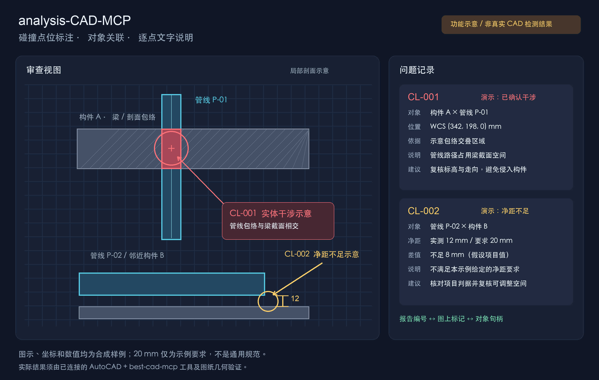
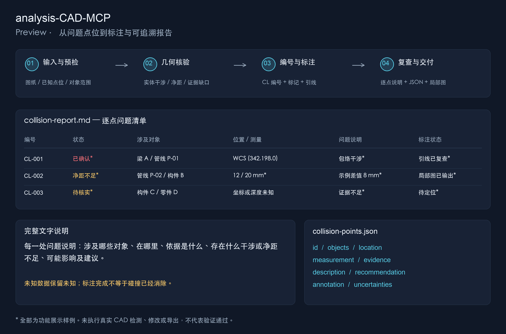

# Preview — analysis-CAD-MCP

以下图片展示本 Skill 的交付形式和信息组织方式。它们是原创合成示意，没有连接 AutoCAD，也没有运行真实图纸的碰撞检测、修改或导出。

## 1. 在视图中标注碰撞点位

左侧展示构件与管线的局部剖面包络，右侧展示与编号对应的文字说明。

- **CL-001 — 实体干涉示意**：红色圈注指向示意交叠区域。文字关联构件 A、管线 P-01、示例 WCS 坐标、问题依据及复核建议。
- **CL-002 — 净距不足示意**：黄色圈注指向示意间隙，同时给出假设的实测 12 mm、项目要求 20 mm 和差值 8 mm。实际项目必须使用其真实要求，不能套用这组数字。
- **位置与对象**：编号关联真实执行时获得的句柄、坐标系、单位及位置依据。干涉区域没有可靠代表点时，以“近似区域/待定位”描述，不虚构精确坐标。

图中颜色只是阅读辅助。真实交付需通过文字明确说明状态，候选或用户提供的位置也不能自动升级为“几何已确认”。

## 2. 从点位到可追溯报告

上方是四个阶段：**输入与预检 → 几何核验 → 编号与标注 → 复查与交付**。用户已经提供点位时，可以登记并说明点位，无需擅自进行全图审查。

中间的问题表展示三种状态：确认干涉、净距问题和待核实。真实报告的每一行需保留证据、覆盖范围和未完成项；截图/VLM 候选、包围盒重叠及缺失的深度数据均不能单独作为三维碰撞证明。

下方展示两类输出：

1. **`collision-report.md`**：供人阅读的对象、位置、问题、依据、可能影响、建议和待核实事项。
2. **`collision-points.json`**：供后续改文字、重新定位或复查使用的编号、句柄、坐标、测量与状态记录。

图上编号、引线文字、报告记录和局部视图应一一对应。标注状态与检测状态分别保存；标注完成不会自动把碰撞状态改成“已解决”。

## 3. 功能验证状态

| 项目 | 本次状态 |
|---|---|
| Skill 指令与参考模块 | 已整理 |
| 格式、命名和文件引用 | 已检查 |
| Preview 图片 | 已制作并检查排版 |
| MCP / AutoCAD 实时连接 | 尚未验证 |
| 真实图纸上的检测、标注、导出 | 尚未验证 |

实际运行依赖 `best-cad-mcp`、Windows 和 AutoCAD。检测能力、测量精度和输出形式以当前工具及输入几何为准；这是 Skill 包，不是完整的 CAD 内核或新 MCP 服务。

## 4. 如何调整本 Skill

- 修改 [SKILL.md](SKILL.md) 可以调整触发条件和工作流入口。
- 修改 [collision-annotation.md](references/collision-annotation.md) 可以调整编号、点位字段、图层、文字格式、标注方法与报告要求。
- 项目对象集合、规范和最小净距在任务中提供或从图纸/项目资料读取；不要将某次示例要求固化为通用标准。

基础装配图工作流来自 [best-cad-mcp](https://github.com/LokmenoWer/best-cad-mcp)，上游 MIT 版权声明保留。两张 Preview 图片由本项目独立制作，均为示意，不代表上游演示或已通过真实 CAD 验证。
